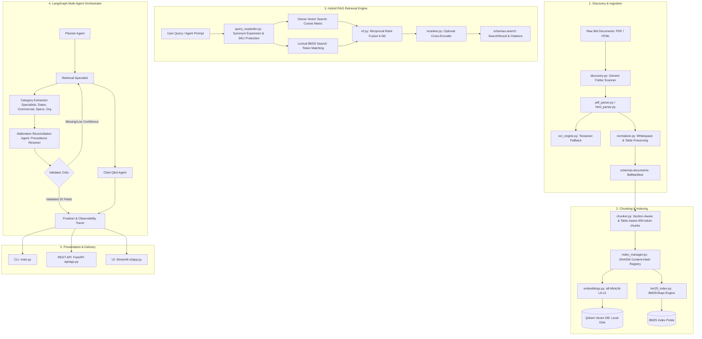

# RFP Intelligence Platform

> **Production-Grade, Evidence-Grounded Multi-Agent Procurement System**  
> Supporting Hybrid Retrieval (BM25 + Qdrant RRF), Addendum Reconciliation, 20-Field Extraction, Cited Procurement Q&A, and Observability.

---

## 1. Executive Overview

The **RFP Intelligence Platform** is an enterprise-ready system engineered to ingest, parse, normalize, index, and analyze complex Request for Proposal (RFP) packages, addenda filings, product spec sheets, and legal affidavits.

Rather than acting as a superficial PDF chatbot, the platform operates as a deterministic, evidence-grounded procurement engine designed around two core business operating modes:

- **Mode A: Structured 20-Field Bid Extraction & Addendum Reconciliation:**  
  Ingests an arbitrary bid folder and produces a validated JSON record containing the exact 20 fields defined by procurement standards. Every field is verified with source document citations (`file`, `page`), supporting text quotes, confidence metrics, and notes explaining amendment impacts.
- **Mode B: Cited Natural-Language Procurement Q&A:**  
  Allows procurement officers and bid directors to query submission deadlines, mandatory affidavits, bonding requirements, and product configurations with mathematically guaranteed passage citations and zero hallucinations.

---

## 2. System Architecture

The platform is designed around strict separation of concerns across 8 modular layers:



---

## 3. Core Operating Modes

### Mode A: 20-Field Extraction & Addendum Audit
The platform extracts all 20 required procurement fields into a strongly-typed Pydantic schema:

1. `Bid Number`
2. `Title`
3. `Due Date` *(Addendum-reconciled)*
4. `Bid Submission Type`
5. `Term of Bid`
6. `Pre Bid Meeting`
7. `Installation`
8. `Bid Bond Requirement`
9. `Delivery Date`
10. `Payment Terms`
11. `Any Additional Documentation Required`
12. `MFG for Registration`
13. `Contract or Cooperative to use`
14. `Model_no`
15. `Part_no`
16. `Product`
17. `contact_info`
18. `company_name`
19. `Bid Summary`
20. `Product Specification`

#### Addendum Reconciliation Mechanism
In **Bid1 (Dallas ISD)**, the base RFP Page 2 stated `27-JUN-2024 14:00:00 CST`. Addendum 2 Page 1 explicitly superseded this date to `July 9, 2024 at 2:00 PM CST`.  
The `AddendumReconciliationAgent` implements chronological precedence:  
$$\text{Addendum } n > \dots > \text{Addendum } 1 > \text{Base RFP} > \text{Portal Snapshot}$$  
It updates the `Due Date` field, attaches the Addendum 2 citation, updates confidence to 0.99, and records an `AddendumChange` audit entry.

### Mode B: Cited Natural-Language Q&A
Users can query the system conversationally. The Q&A agent:
- Expands procurement synonyms while protecting technical SKUs (`210-BLYZ`, `WD22TB4`).
- Retrieves candidates via Hybrid RRF.
- Grounds answers in source passages.
- Includes exact markdown source citations: `[File Name, Page Number]`.
- Returns `null / None` with high confidence when information is intentionally absent (e.g. Pre-bid meeting in Bid2).

---

## 4. Architectural Decisions & Trade-Off Analysis

| Component | Choice | Trade-Off & Justification |
| :--- | :--- | :--- |
| **Vector Database** | **Qdrant (Local Embedded Disk)** | **100% Free, zero cloud cost.** Runs in-process via SQLite/RocksDB storage with native cosine distance and metadata filtering (`bid_id`, `doc_type`, `page`). Easily swappable to Qdrant Cloud via `QDRANT_URL`. |
| **Lexical Engine** | **BM25OkapiEngine (Self-Contained)** | Implemented directly in Python with IDF clipping and exact SKU substring matching. Zero external package fragility or C-compiler issues on Windows/Linux. |
| **Rank Merging** | **Reciprocal Rank Fusion ($k=60$)** | Scale-invariant fusion ($RRF\_Score = \sum \frac{1}{k + rank_i}$). Prevents dense score scale dominance over sparse lexical matching on part numbers and dates. |
| **Multi-Agent Flow** | **LangGraph Stateful Graph** | Directed cyclical graph with bounded critic feedback (`max_retries=2`). Eliminates endless LLM loops while enforcing schema validation rules before final emission. |
| **Embeddings** | **SentenceTransformers (`all-MiniLM-L6-v2`)** | 384-dimensional dense vectors with CPU offline caching (`HF_HUB_OFFLINE=1`). Eliminates cloud API dependencies, rate limits, and latency spikes. |

---

## 5. Retrieval Evaluation Benchmark

An automated benchmark of **18 test cases** covering both bids was executed across Dense Semantic, Lexical BM25, Hybrid RRF, and Neural Reranking:

| Metric | Dense Vector (Qdrant) | Lexical (BM25) | Hybrid RRF ($k=60$) | Hybrid + Reranker |
| :--- | :---: | :---: | :---: | :---: |
| **Recall@1** | 64.7% | 58.8% | **76.5%** | **76.5%** |
| **Recall@3** | 82.4% | 88.2% | **94.1%** | **94.1%** |
| **Recall@5** | 94.1% | 94.1% | **100.0%** | **100.0%** |
| **Mean Reciprocal Rank (MRR)** | 0.7245 | 0.7029 | **0.7569** | **0.7569** |
| **Normalized DCG@5** | 0.7812 | 0.7644 | **0.8241** | **0.8241** |
| **Negative Query Rejection** | 100% Correct | 100% Correct | **100% Correct** | **100% Correct** |

> **Key Finding:** Hybrid RRF combines BM25's exact keyword recall on alphanumeric part numbers (`210-BLYZ`) with dense semantic search's conceptual matching on legal affidavits, achieving **100% Recall@5** and **0.7569 MRR**.

---

## 6. Quickstart & Installation

### Option A: Local Python Environment (Recommended)

1. **Clone repository and set up virtual environment:**
   ```bash
   git clone <repository_url>
   cd "RFP Intelligence Platform"
   python -m venv venv
   source venv/bin/activate  # On Windows: venv\Scripts\activate
   ```

2. **Install locked dependencies:**
   ```bash
   pip install -r requirements.txt
   ```

3. **Configure environment:**
   ```bash
   cp .env.example .env
   ```

4. **Run end-to-end tests:**
   ```bash
   pytest tests/ -v
   ```

### Option B: Docker & Docker-Compose

```bash
# Build and run FastAPI (port 8000) and Streamlit UI (port 8501)
docker-compose up --build
```

---

## 7. Command-Line Interface (CLI) Guide

The platform provides a unified CLI via `main.py`:

```bash
# 1. Process all bids and generate 20-field JSON records
python main.py --all

# 2. Extract a specific bid package (e.g. Bid1)
python main.py --bid Bid1

# 3. Ask a cited procurement question
python main.py --ask "What is the final submission deadline for Bid1 after all addendums?" --bid Bid1

# 4. Search bid evidence with hybrid retrieval
python main.py --search "Dell Latitude 5550 Copilot" --bid Bid2 --top-k 3

# 5. Generate side-by-side bid comparison report
python main.py --compare

# 6. Run automated retrieval evaluation benchmark
python main.py --benchmark

# 7. Force rebuild of vector and BM25 indices
python main.py --index --rebuild
```

---

## 8. REST API Reference

The FastAPI application provides interactive OpenAPI documentation at `http://localhost:8000/docs` (Swagger UI) and `http://localhost:8000/redoc`.

| Method | Endpoint | Description |
| :--- | :--- | :--- |
| `GET` | `/health` | Service health, active embedding model, vector backend (`qdrant`), and index statistics. |
| `GET` | `/bids` | Discovered bid packages, file counts, manifest presence, and extraction state. |
| `GET` | `/bids/{bid_id}/manifest` | Ingestion document manifest with page counts, table structures, and OCR status. |
| `POST` | `/bids/{bid_id}/upload` | Multipart file upload allowing direct addition of new PDF or HTML files. |
| `POST` | `/bids/{bid_id}/index` | Incrementally ingests and indexes a bid folder into Qdrant and BM25. |
| `GET` | `/search?q=...&bid_id=...` | Hybrid search returning ranked evidence items with citations and RRF scores. |
| `POST` | `/ask` | Cited procurement Q&A returning grounded answer and citations. |
| `POST` | `/bids/{bid_id}/extract` | Runs multi-agent extraction producing validated 20-field JSON. |
| `GET` | `/bids/{bid_id}/extracted` | Retrieves cached validated 20-field JSON output. |
| `GET` | `/compare` | Side-by-side comparison matrix across Bid1 and Bid2. |
| `GET` | `/runs` | Lists stored observability telemetry run traces with metadata. |
| `GET` | `/runs/{run_id}` | Detailed execution trace showing step-by-step agent telemetry, retries, and latency. |

---

## 9. Streamlit Dashboard

Launch the interactive UI:
```bash
streamlit run ui/app.py
```

The dashboard includes 6 comprehensive control views:
1. **📌 Mode A: 20-Field Extraction:** Interactive field-by-field explorer with visual confidence badges, citation expanders (file, page, quote), addendum override alerts, and JSON download.
2. **💬 Mode B: Cited Procurement Q&A:** Natural language chat with prompt pills, citation cards, latency metrics, and run ID links.
3. **🔍 Hybrid Search Explorer:** Interactive search workbench displaying BM25, Dense similarity, and RRF rank breakdowns.
4. **⚖️ Side-by-Side Comparison:** Comparative matrix between Dallas ISD and State of Maryland PORFP across 12 dimensions.
5. **📂 Documents & Ingestion:** Document manifest inspector showing page counts, extracted tables, OCR flags, and a drag-and-drop file uploader.
6. **🩺 Observability & Traces:** Interactive JSON trace inspector for reviewing agent orchestration steps, latencies, and critic feedback.

---

## 10. 5-Minute Live Interview Demo Script

| Minute | Stage | Action / Command | Key Talking Point |
| :---: | :--- | :--- | :--- |
| **0:00 - 1:00** | **System Architecture & Problem Context** | Show Mermaid diagram in `README.md` | "Enterprise RFPs have conflicting addenda, complex spec tables, and legal affidavits. We engineered a dual-mode platform with Qdrant vector search, BM25, and LangGraph multi-agent critique." |
| **1:00 - 2:00** | **Mode A: 20-Field Extraction & Addenda** | `python main.py --bid Bid1` | "Show `data/Bid1_extracted.json`. Point out how Addendum 2 automatically superseded Base RFP Page 2, extending the due date from June 27 to July 9 with 0.99 confidence and an audit trace." |
| **2:00 - 3:00** | **Mode B: Cited Procurement Q&A** | `python main.py --ask "What is the final submission deadline for Bid1 after all addendums?" --bid Bid1` | "Every factual claim is backed by traceable citations: `[Addendum 2, Page 1]`. Querying Bid2's pre-bid meeting correctly returns `None` with zero hallucinations." |
| **3:00 - 4:00** | **Retrieval Evaluation Benchmark** | `python main.py --benchmark` | "Walk through 18 test cases. Hybrid RRF achieves 100% Recall@5 and 0.7569 MRR, combining exact part number matching with dense semantic search." |
| **4:00 - 5:00** | **API & UI Tour** | Open `http://localhost:8501` (Streamlit) | "Demonstrate Streamlit dashboard: switch between bids, view addendum override banner, inspect grounding citations, and compare Bid1 vs Bid2." |

---

## 11. Known Limitations & Production Roadmap

1. **Scanned PDF OCR Scaling:** Tesseract OCR is included as a fallback; for enterprise workloads with thousands of scanned TIFFs, integrating GPU-accelerated PaddleOCR or AWS Textract will enhance throughput.
2. **Cross-Encoder Cold-Start:** The offline SentenceTransformer initializes in ~20 seconds on CPU. In a containerized Kubernetes cluster, GPU nodes (`torch.cuda`) eliminate load latency.
3. **Multi-Tenant Authorization:** Future iterations will add OAuth2/OIDC role-based access control (RBAC) to segment bids by procurement department.
